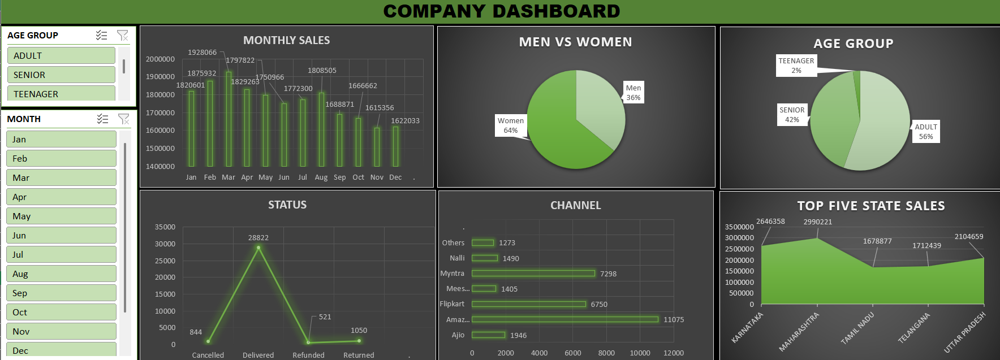

# Vrinda Store Sales Analysis Dashboard

An interactive **E-commerce Sales Analysis Dashboard** built using Microsoft Excel to analyze sales performance, customer demographics, order status, sales channels, and state-wise sales.

## Dashboard Preview



## Project Overview

This project involves analyzing Vrinda Store's e-commerce sales data and transforming it into an interactive Excel dashboard.

The dashboard provides meaningful insights into monthly sales trends, customer purchasing patterns, gender distribution, order fulfilment, sales channels, and geographical performance.

## Tools & Technologies

- Microsoft Excel
- Data Cleaning and Analysis
- Pivot Tables (if used in the workbook)
- Pivot Charts (if used in the workbook)
- Excel Slicers
- Data Visualization
- Interactive Dashboards

## Dashboard Features

### 1. Monthly Sales Analysis
Visualizes monthly sales performance to identify sales trends and fluctuations throughout the year.

### 2. Gender Analysis
Compares the sales distribution between male and female customers.

### 3. Age Group Analysis
Segments customers into three categories:
- Adult
- Senior
- Teenager

### 4. Order Status Analysis
Provides an overview of order statuses:
- Delivered
- Cancelled
- Refunded
- Returned

### 5. Sales Channel Analysis
Compares sales performance across different e-commerce platforms, including:
- Amazon
- Flipkart
- Myntra
- Ajio
- Meesho
- Nalli
- Others

### 6. Top Five State Sales
Identifies the five highest-performing states based on sales.

## Interactive Features

The dashboard includes Excel slicers that allow users to filter data by:

- Month
- Age Group

These interactive filters make it easier to explore different customer segments and sales patterns.

## Dataset Description

The dataset contains e-commerce order information, including:

- Order ID
- Customer ID
- Gender
- Age
- Order Date
- Order Status
- Sales Channel
- Product Category
- Product Size
- Quantity
- Amount
- Shipping Location

## Key Business Objectives

- Analyze monthly sales performance.
- Understand customer demographics and purchasing patterns.
- Evaluate order fulfilment and return trends.
- Compare performance across different sales channels.
- Identify top-performing geographical regions.
- Present business insights through interactive visualizations.

## How to Use

1. Download the Excel dashboard file from this repository.
2. Open the workbook using Microsoft Excel.
3. Navigate to the **DASHBOARD** worksheet.
4. Use the Month and Age Group slicers to filter the dashboard.
5. Explore the charts to understand different aspects of sales performance.

## Project Structure

```text
Vrinda-Store-Sales-Analysis/
│
├── Vrinda_Store_Sales_Dashboard.xlsx
├── dashboard_preview.png
├── README.md
│
└── data/
    └── Vrinda_Store_Data.xlsx
```

## Project Category

Data Analytics | Business Intelligence | Excel Dashboard | Data Visualization
